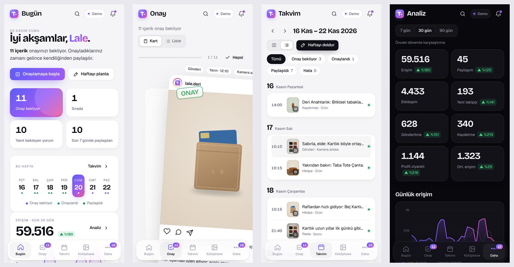
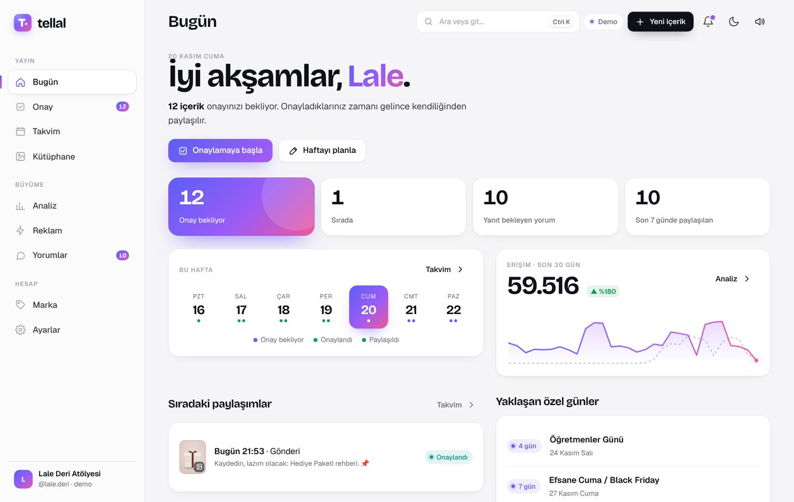
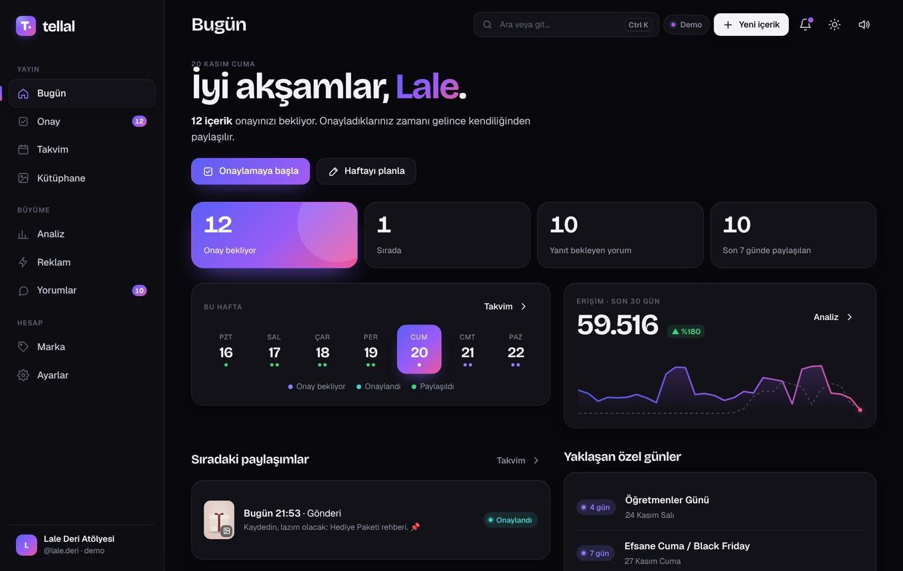
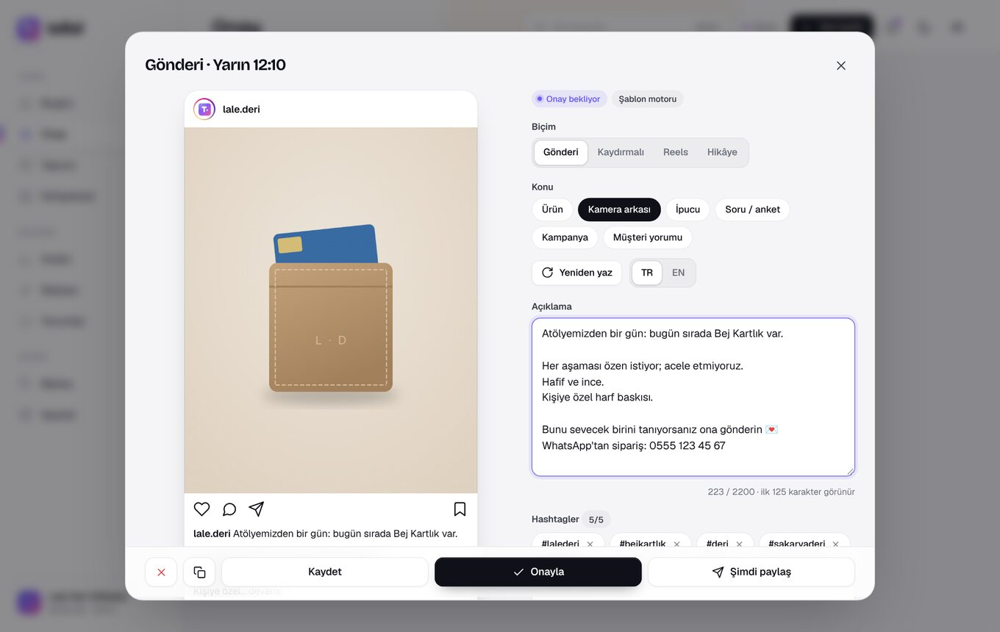
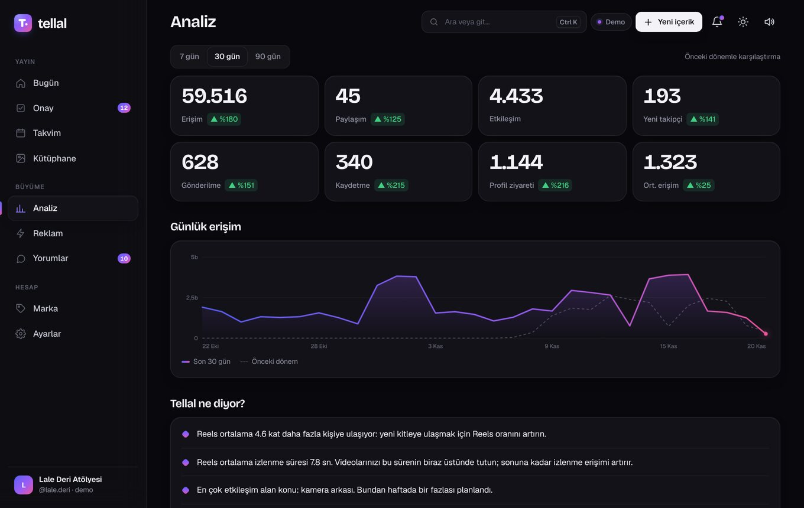
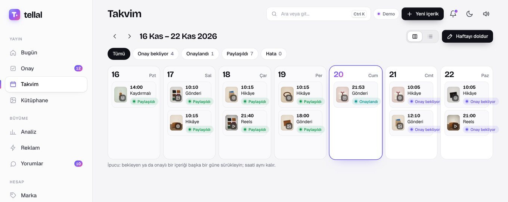
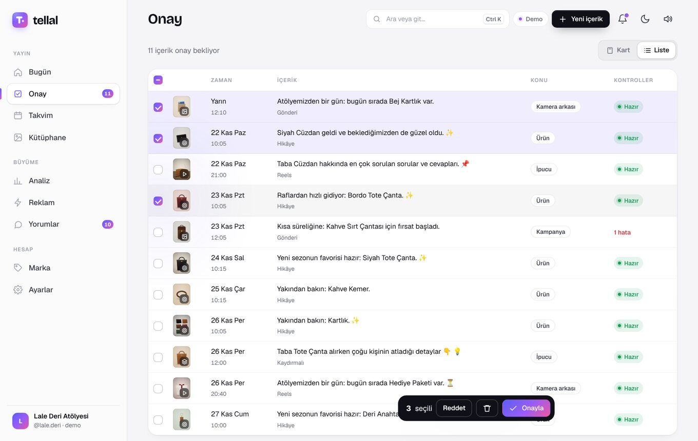
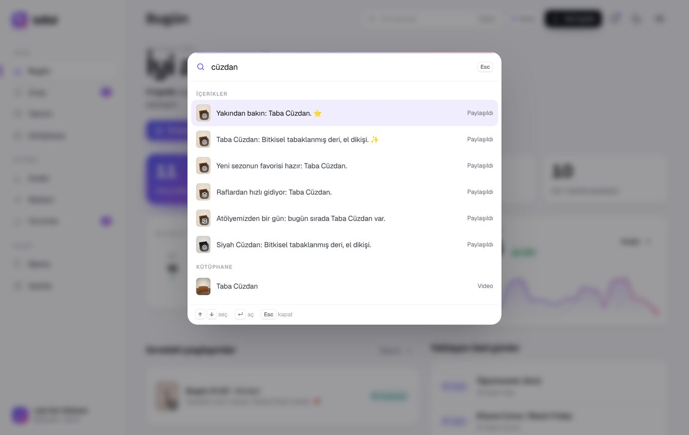

# Tellal


**A social media assistant for small businesses. It plans the week, writes the posts from your own photos, explains why, publishes on time and tells you what worked. You have the last word on everything.**

Tellal takes the photos and short videos a shop owner already has, plus a few notes ("full-grain leather, inner pocket, fits a 14-inch laptop"), and turns them into a week of Instagram posts, carousels, Reels and Stories. Each one waits in a swipe-to-approve queue with an Instagram-style preview, a list of checks and the reasons behind it ("Tuesday 20:00: your posts did best around this time"). Approved items are published on schedule. Afterwards it compares results *per reach*, learns your best hours, drafts replies to comments and points at the posts worth boosting, with honest budget ranges. It never spends money and never posts anything you didn't approve.

> *Tellal* is the town crier of old Turkish bazaars: the person who walked the market announcing what each shop had.

**▶ Live demo: https://numanak-b221210105.github.io/tellal/** (the whole app runs in your browser with a made-up leather workshop; installable on phone and desktop)



> 🇹🇷 **Türkçe özet:** Esnaf ve küçük işletmeler için sosyal medya asistanı. Kendi ürün fotoğraflarınızdan ve kısa notlarınızdan haftalık Instagram planı çıkarır: gönderi, kaydırmalı gönderi, Reels ve hikâye. Her içerik, Instagram görünümünde bir önizleme, kontrol listesi ve "neden bu saat, neden bu konu" açıklamasıyla onayınıza gelir; sağa kaydırınca onaylanır ve zamanı gelince kendiliğinden paylaşılır. Sonra sonuçları erişim başına karşılaştırır, en iyi saatlerinizi öğrenir, yorumlara yanıt taslağı hazırlar ve öne çıkarmaya değer gönderiler için bütçe ve erişim aralığı önerir. Para harcamaz, onaylamadığınız hiçbir şeyi paylaşmaz, yorum, fiyat ya da indirim uydurmaz. Türkiye'deki reklam kurallarını (reklam/iş birliği ibaresi, indirimde son 30 günün en düşük fiyatı, yapay zekâ etiketi) paylaşımdan önce denetler. Türkçe, İngilizce, Sırpça, Hırvatça ve Rumence içerik yazar. Telefona uygulama olarak kurulur.

## Why

A small shop on Instagram usually has three problems: no time to post regularly, no idea *what* the algorithm rewards, and no clear way to decide whether a boost is worth 300 TL. Existing tools tend to solve one of these. Schedulers post what you give them. AI writers produce text but don't know the platform's limits or local ad rules, and some will cheerfully invent a "customer review". Tellal is built around a few rules:

| Rule | What it means in practice |
|---|---|
| **The owner decides** | Everything goes through an approval queue. Edit a post after approving it and it goes back for another look. The scheduler only ever touches approved items. |
| **Nothing is invented** | No fake reviews, prices, discounts or awards. Missing facts become `[placeholders]` that block approval until they are filled in. Prices come only from the brand profile. |
| **Explain every choice** | Each draft lists why: the hour (learned from your data or general Turkish usage), the topic mix, the format, the ranking signal it is aiming for. |
| **Use your own content** | Tellal does not generate images. It works with the business's real photos and videos and helps prepare them (crop to 4:5 or 9:16, JPEG conversion, a 9:16 story image with the text printed on). |
| **Know the limits** | 2,200-character captions, the first ~125 characters as the hook, **at most 5 hashtags per post** (Instagram's limit since December 2025, caption and first comment included), JPEG only, 4:5 to 1.91:1 in the feed, 9:16 for Reels and Stories, Reels length, carousel size, quiet hours. |
| **Local rules too** | Checks based on Turkey's Commercial Advertising Regulation (amended, in force from 1 August 2026): a clear `#reklam` / *iş birliği* disclosure at the *start* of sponsored posts, the lowest price of the last 30 days when announcing a discount, AI-generated visuals labelled, no unprovable superlatives or health claims. It is a checklist, not legal advice. |

## What it does

| | |
|---|---|
| **Weekly plan** | Fills the next 7 days up to the rhythm you set (for example 3 posts, 2 Reels, 1 story a day). Spreads days, picks the least-used photo or video for each slot, turns every third feed post into a carousel when there are photos that belong together, keeps videos for Reels and falls back to a photo post (and says so) when there aren't enough. Writes for upcoming Turkish occasions (Mother's Day, Black Friday, Teachers' Day, Ramadan and Sacrifice holidays…). |
| **Drafts** | Hook in the first line, details from your notes and selling points, an invitation to *send* or *save* (sends and saves per reach are among Instagram's strongest signals), your call to action (DM, WhatsApp, link, visit, call), up to 5 hashtags (brand, product, sector, city). Reels get an on-screen hook and a 7–12 second shot plan; stories get three frames and a sticker suggestion; carousels get slide texts. Rewrite, change topic, format or language with one tap. |
| **Review** | A swipe deck on the phone (right: approve, left: reject, tap: edit) with an Instagram-like preview. Errors (placeholders, wrong ratio, too many hashtags, missing disclosure) block approval; warnings and tips are shown. "Approve the ready ones" approves everything without errors in one go. Every decision can be undone from the toast; on desktop, <kbd>←</kbd> <kbd>→</kbd> <kbd>E</kbd> work too. A list view shows everything waiting in one table, with checkboxes for approving, rejecting or deleting many at once. |
| **Publishing** | Instagram's container flow: create, wait until processed (videos take a while, so the scheduler comes back later instead of blocking), publish, then add the optional first comment. Checks the 24-hour publishing limit first. Network and rate-limit errors are retried with backoff; permanent errors stop and are shown. 60-day tokens are refreshed automatically. |
| **Insights** | Reach, sends, saves, comments, follows and Reel watch time per post. Compares formats and topics *per reach*, draws a weekday × hour heatmap, learns your two best hours per weekday once there are 8+ posts, and writes plain-language advice ("Reels reach 4.6× more people", "behind-the-scenes posts get the most interaction, the plan adds one more per week"). |
| **Comments** | Pulls new comments, sorts them by intent (price, stock, order, question, praise, complaint, spam) and drafts a reply that uses your real contact details and prices. Complaints never get a template: they are flagged for a personal answer. Your own wording can be saved as one-tap replies. Nothing is sent until you press reply. |
| **Ad suggestions** | Picks posts that clearly beat your median organically (boosting a proven post is the cheapest reach), and gives three budget options with total cost, Meta's 5% location fee for Turkey, CPM ranges for the format and season, and estimated reach as a range. Includes targeting ideas and notes on VAT. **Recommendation only.** |
| **Calendar** | Week columns or a day-by-day agenda, filtered by status. On desktop, drag a post to another day; it keeps its hour and, if it was approved, stays approved. |
| **Brand profile** | Sector, city, tone (warm, professional, playful, elegant, plain), emoji level, content languages, selling points, products and prices, banned words, brand hashtag, contact method, rhythm and quiet hours. Also suggests bios (max 150 characters) to copy, because Instagram doesn't let apps change the bio. |
| **Library** | Upload from the phone or desktop; images are cropped and converted to JPEG in the browser, videos are checked for length and orientation and get a poster frame, so lists never download whole videos. Usage counters show what has been used how often. |
| **Search** | <kbd>Ctrl</kbd>/<kbd>⌘</kbd> <kbd>K</kbd> (or <kbd>/</kbd>) opens one box for pages, actions, posts and library items; <kbd>?</kbd> lists the shortcuts. |
| **Backup** | Settings → Download backup writes the brand profile, posts, results and comments to one JSON file (no media, no tokens). |
| **Everywhere** | Mobile-first PWA (installable, dark mode, safe areas, haptics on Android), desktop layout with a sidebar, Turkish and English interface, soft synthesized UI sounds that follow the phone's silent switch, optional panel password. |

| Today (light) | Today (dark) |
|---|---|
|  |  |

| Editor with readiness and checks | Insights |
|---|---|
|  |  |

| Calendar | Review as a list, bulk actions |
|---|---|
|  |  |



## Design

Tellal has its own look rather than a borrowed one. Graphite and white, with one aurora gradient (violet to orchid to rose) used only as a signal: what is waiting for you, the action that matters, the line in a chart. The mark is a rounded **T** with a dot, the crier's announcement. Headings are set in Bricolage Grotesque, the interface in Geist; both are bundled (SIL Open Font License), so it looks the same offline.

Light and dark are designed separately, not inverted: soft ambient light behind the page, glass navigation, a floating dock on phones. Motion is short and purposeful: pages rise in, numbers count up, the reach line draws itself, cards catch a light under the pointer, the theme switch opens as a circle from the button, the review cards move on springs. Everything falls back to still when the system asks for reduced motion.

The editor scores each draft for readiness (hook in the first line, a send or save invite, a call to action, 3–5 hashtags, alt text, time, no errors) so it's clear what's missing before approving. Notifications collect what happened while you were away, and comment replies can be saved and reused.

## Honest limits

- **Meta app and public URL.** Real publishing needs your own Meta app (free) and a server Instagram can reach, because Instagram downloads the media from a public HTTPS URL. A home PC works with a tunnel such as Cloudflare Tunnel or ngrok.
- **Other people's accounts need App Review.** In development mode the app works for accounts that have a role on it (your own and your testers'). Offering it to other businesses requires Meta's App Review.
- **Bio and DMs.** Instagram does not allow changing the bio through the API, so Tellal suggests bios to copy. Replying to DMs (inside Instagram's 24-hour window) is planned for a later version; comments are handled now.
- **Stickers.** Polls, questions and link stickers can't be added to Stories through the API. Tellal prints the story text onto the image and tells you which sticker to add in the app.
- **Numbers in the demo are simulated.** They follow how Instagram behaves (Reels reach more non-followers, evenings do better, a "send this to someone" line raises shares), but they are not real data.
- **Ad costs are ranges.** They move with season and competition. Treat them as a starting point and watch the first two days.

## Run it

### In the browser (no install)

Open the [live demo](https://numanak-b221210105.github.io/tellal/). The original Python app runs inside the page with Pyodide, data stays on the device, and it keeps working offline after the first load. Build it yourself with `python web/build.py`.

### On your computer

Windows: double-click **`start.bat`**. macOS / Linux: `./start.sh`. Both create a virtual environment, install the dependencies, and open `http://localhost:8300` in demo mode.

```bash
pip install -e ".[dev]"
python -m tellal.serve                 # demo mode, opens the browser
python -m tellal.serve --host 0.0.0.0  # also reachable from your phone on the same Wi-Fi
```

Docker:

```bash
docker build -t tellal .
docker run -p 8300:8300 -v tellal-data:/data --env-file .env tellal
```

Command line (useful with cron if you don't keep the server running):

```bash
tellal plan              # plan the next 7 days (everything waits for approval)
tellal tick              # publish due posts, refresh insights and comments once
tellal check             # connected account and today's publishing quota
```

### Connecting Instagram

1. The Instagram account must be a **professional** (business or creator) account.
2. On [developers.facebook.com](https://developers.facebook.com/) create an app and add the **Instagram API with Instagram Login** product.
3. Add these permissions: `instagram_business_basic`, `instagram_business_content_publish`, `instagram_business_manage_comments`, `instagram_business_manage_insights`.
4. Make the server reachable over HTTPS (domain or tunnel) and add `https://YOUR-ADDRESS/auth/instagram/callback` as a valid OAuth redirect URI.
5. Copy `.env.example` to `.env` and set:

```env
TELLAL_MODE=instagram
TELLAL_PUBLIC_URL=https://YOUR-ADDRESS
TELLAL_IG_APP_ID=...
TELLAL_IG_APP_SECRET=...
TELLAL_ADMIN_PASSWORD=choose-one   # the panel is on the internet now
```

6. Start Tellal, open **Settings → Connect Instagram**, and allow access. The token is exchanged for a 60-day token and refreshed automatically.

### Optional language model

Tellal writes everything with its own template engine and needs no model. If an OpenAI-compatible endpoint is reachable (a local [Ollama](https://ollama.com) by default, or any hosted provider), captions are written by the model instead. Its output goes through the same limits and checks: hashtags are moved out of the caption and capped, the disclosure is moved to the first line, and anything missing is filled from the template draft. If the model is down, Tellal falls back silently.

## How it works

```
photos + notes ─▶ planner ─▶ drafts (pending) ─▶ owner approves ─▶ scheduler ─▶ Instagram
                    ▲                                                   │
                    └──── best hours, best topics ◀── insights ◀────────┘
                                                        └─▶ ad suggestions, comment drafts
```

| File | |
|---|---|
| `src/tellal/content.py` | Template engine in 5 languages, hashtags, occasions, optional model path with the same guarantees |
| `src/tellal/compliance.py` | Instagram limits and Turkish advertising rules as error / warning / tip findings |
| `src/tellal/planner.py` | Weekly plan: days, hours, formats, topic mix, media choice, reasons |
| `src/tellal/scheduler.py` | Publishing with retries and backoff, insights and comment refresh, token refresh |
| `src/tellal/providers/instagram.py` | Graph API client: containers, carousels, Reels, Stories, insights, comments, quota |
| `src/tellal/providers/demo.py` | Simulated account with realistic, deterministic numbers |
| `src/tellal/analytics.py` | Per-reach rates, format/topic comparison, heatmap, best hours, advice |
| `src/tellal/ads.py` | Boost candidates, budget tiers, CPM ranges, targeting and notes |
| `src/tellal/inbox.py` | Comment intent and reply drafts |
| `src/tellal/api.py` | FastAPI app, signed public media URLs for Instagram, OAuth, optional password |
| `src/tellal/static/` | The web app (plain JavaScript, no build step) |
| `web/` | In-browser build (Pyodide) for GitHub Pages |

Storage is a single SQLite file plus a media folder under `TELLAL_DATA_DIR`. The scheduler runs as a background thread in the server; in the browser build the open page drives it.

## Tests

```bash
pytest -q          # content, checks, planner, scheduler retries, API flows, Instagram client (mocked)
ruff check src tests
```

The Instagram client is tested against a mocked Graph API: photo, carousel and Reel flows, processing videos, error classification (expired token vs. rate limit), insight metric fallback, comments and replies.

## Roadmap

- DM replies within Instagram's 24-hour window, with the same approval flow
- Facebook Page, Threads and TikTok providers (the provider interface is platform-neutral)
- Hook A/B suggestions based on each account's own Reel retention
- Multiple brands per installation for small agencies

## License

MIT
